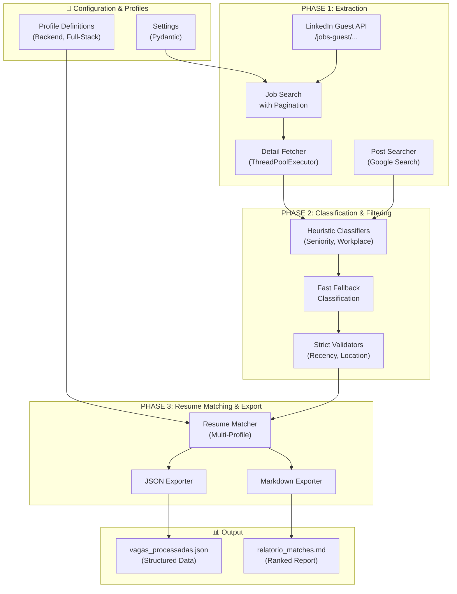

# 🚀 Job Search - LinkedIn Job & Post Scraper with Automated Resume Matching

[](https://www.python.org/)
[](https://github.com/astral-sh/uv)
[](https://www.linkedin.com/jobs)
[](https://github.com/astral-sh/ruff)
[](LICENSE)

A modular, production-grade Python automation tool designed to discover, extract, and analyze tech job listings and LinkedIn posts into structured JSON data and formatted Markdown reports.

The system features an **automated resume matching engine** with dynamic multi-profile support (Backend Python, Full-Stack Python, and custom profiles), **concurrent detail fetching** via LinkedIn Guest API endpoints, **optional HTTP proxy rotation** for resilience, and **Google-powered post discovery**—all without requiring credentials or session cookies.

---

## 🌟 Key Features

- **🔑 Zero Authentication**: Leverages public LinkedIn Guest endpoints (`/jobs-guest/jobs/api/...`) and Google Search without API keys, login accounts, or cookies.
- **🏗️ Modular Architecture**: Cleanly separated domains (Jobs, Posts, Matchers, Exporters) with strict Pydantic schemas and single responsibilities.
- **⚡ Concurrent Processing**: Multi-threaded job detail fetching via `ThreadPoolExecutor` for aggressive parallelism without overwhelming targets.
- **🌍 Optional Proxy Rotation**: Dynamic HTTP proxy pool with async pre-flight validation, automatic failover, and adaptive strategy (Round-Robin, Active Pool, Adaptive Failover).
- **🎯 Smart Filtering**: Heuristic-based seniority, workplace type, and recency filtering with fast classification fallback.
- **🧠 Dynamic Resume Matching**: Evaluates job descriptions against configurable profiles, calculating compatibility scores based on skill keywords, technical depth, and multi-profile rankings.
- **💬 Dual Discovery Modes**: Formal LinkedIn Jobs API search + informal LinkedIn Feed Posts via Google Search (toggle on/off).
- **📊 Multi-Format Exports**: Structured JSON datasets + ranked, human-readable Markdown reports with dynamic profile scoring.

---

## 🏗️ Architecture & Workflow



---

## 📁 Repository Structure

```
job-search/
├── app/
│   ├── core/
│   │   ├── config.py                # Central Settings (Pydantic) with all operational flags
│   │   └── logging.py               # Structured logger setup
│   │
│   ├── models/                      # Strict Pydantic schemas
│   │   ├── enums.py                 # ScopeEnum, SeniorityEnum, WorkModelEnum, MatchLevelEnum, etc.
│   │   ├── job.py                   # JobItem schema (LinkedIn formal jobs)
│   │   ├── post.py                  # PostItem schema (LinkedIn feed posts)
│   │   ├── match.py                 # ProfileMatch, ResumeMatch schemas
│   │   └── report.py                # ProcessedDataOutput, ScopeContainer schemas
│   │
│   ├── profiles/                    # Profile management (decoupled keywords, rules, queries)
│   │   ├── base.py                  # Profile and ScoringRule Pydantic models
│   │   ├── predefined.py            # Predefined profiles (Backend Python, Full-Stack Python)
│   │   └── __init__.py              # Exports and defaults
│   │
│   ├── jobs/                        # Jobs domain (LinkedIn formal jobs)
│   │   ├── queries.py               # Default search queries (national & international)
│   │   ├── classifiers.py           # Heuristics for seniority, workplace type, pre-filtering
│   │   ├── fetcher.py               # LinkedIn Guest API search & pagination
│   │   ├── detail_fetcher.py        # Concurrent detail fetching & fast classification
│   │   ├── runner.py                # Standalone direct jobs search runner
│   │   └── facade.py                # JobsPipelineFacade (orchestration)
│   │
│   ├── posts/                       # Posts domain (LinkedIn feed posts via Google)
│   │   ├── fetcher.py               # Google Search scraper & proxy rotation
│   │   ├── runner.py                # Standalone direct posts search runner
│   │   └── facade.py                # PostsPipelineFacade (orchestration)
│   │
│   ├── shared/                      # Shared infrastructure
│   │   └── http/
│   │       ├── proxy_sources.py     # Multi-source proxy aggregator
│   │       ├── proxy_rotator.py     # Dynamic HTTP proxy pool & rotation strategies
│   │       └── client.py            # Resilient HTTP client with failover
│   │
│   ├── matchers/                    # Resume matching engine
│   │   ├── skills_definitions.py    # Skill keyword definitions
│   │   └── resume_matcher.py        # Multi-profile matching & scoring
│   │
│   ├── exporters/                   # Data export & persistence
│   │   ├── json_exporter.py         # JSON serialization
│   │   └── markdown_exporter.py     # Markdown report generation
│   │
│   ├── facades/                     # Orchestration facades
│   │   └── job_search_facade.py     # JobSearchMasterFacade (coordinates all domains)
│   │
│   ├── data/                        # Generated output files
│   │   ├── relatorio_matches.md     # Generated Markdown report
│   │   ├── vagas_linkedin.json      # Raw extracted jobs
│   │   ├── vagas_processadas.json   # Processed jobs with matches
│   │   └── test_posts.json          # Sample test data
│   │
│   ├── main.py                      # Minimal entry point
│   └── pos_processamento.py         # Standalone post-processing runner
│
├── docs/                            # Documentation & profiles
│   ├── how_to_query.md              # Query reference guide
│   ├── Miguel's Resume - Backend.md # Backend profile resume
│   └── Miguel's Resume - Full-stack.md # Full-Stack profile resume
│
├── tests/                           # Test suite
│   └── test_startup_and_proxy.py    # Startup & proxy validation tests
│
├── data/                            # Additional data storage
│   ├── vagas_linkedin.json          # Cache of extracted jobs
│   └── vagas_pos_processadas.json   # Cache of processed jobs
│
├── GEMINI.md                        # Detailed architecture & code guidelines for AI agents
├── README.md                        # This file
├── pyproject.toml                   # Project config, dependencies, Ruff settings
├── uv.lock                          # Dependency lockfile (managed by uv)
└── .python-version                  # Python version specification
```


---

## ⚡ Tech Stack & Environment

- **Language**: Python `>= 3.14`
- **Package & Environment Manager**: [`uv`](https://github.com/astral-sh/uv)
- **Data Validation**: [`pydantic`](https://docs.pydantic.dev/) (v2)
- **Code Quality**: [`ruff`](https://github.com/astral-sh/ruff) (linting, formatting, import sorting)
- **Key Dependencies**:
  - `requests`, `httpx`, `curl-cffi`: HTTP clients with proxy support
  - `beautifulsoup4`: HTML parsing for LinkedIn & Google Search
  - `pydantic`: Data validation and schema definition
  - `googlesearch-python`: Google Search integration for post discovery
  - `tabulate`, `tqdm`: CLI utilities for progress and formatting
  - `python-dotenv`: Environment variable management

---

## 🚀 Quick Start

### Prerequisites

Ensure you have Python `>= 3.14` and [`uv`](https://github.com/astral-sh/uv) installed.

```bash
# Install uv (if not already installed)
curl -LsSf https://astral.sh/uv/install.sh | sh
```

### Setup Instructions

1. **Clone the repository**:
   ```bash
   git clone https://github.com/your-username/job-search.git
   cd job-search
   ```

2. **Synchronize environment & dependencies**:
   ```bash
   uv sync
   ```

---

## ⚙️ Configuration & Execution

### Core Settings Configuration

All runtime settings are centralized in `app/core/config.py` via the `Settings` Pydantic model. Key configuration options:

```python
# core/config.py example configuration
class Settings(BaseSettings):
    # Search & Filtering
    filtro_tempo: TimeFilterEnum = "r604800"              # r86400 (24h), r604800 (7d), r2592000 (30d)
    apenas_remoto: bool = True                            # Filter for 100% remote only
    senioridade_filtro: SeniorityEnum = "JUNIOR"          # "JUNIOR", "PLENO", "SENIOR", "TODAS"
    
    # HTTP & Proxy Configuration
    usar_proxy: bool = False                              # Enable HTTP proxy rotation
    estrategia_proxy: str = "ROUND_ROBIN"                 # Proxy rotation strategy
    max_concurrency_proxies: int = 5                      # Concurrent proxy validation
    max_workers: int = 10                                 # ThreadPoolExecutor workers for detail fetching
    
    # Posts & Post-Processing
    buscar_posts: bool = False                            # Enable/disable LinkedIn Posts discovery
    enriquecer_detalhes: bool = False                     # Fetch full job details during extraction
    
    # Output
    output_raw_json: str = "data/vagas_linkedin.json"     # Raw extraction output
    output_processed_json: str = "data/vagas_processadas.json"  # Processed output
    output_markdown: str = "app/data/relatorio_matches.md"      # Markdown report output
```

### Running the Complete Pipeline

Execute the full extraction, classification, and resume matching workflow:

```bash
uv run python -m app.main
```

**What happens**:
1. **PHASE 1**: Extracts formal LinkedIn jobs and optional posts
2. **PHASE 2**: Classifies by seniority, workplace type, and applies filters
3. **PHASE 3**: Evaluates all jobs against resume profiles and exports results

### Standalone Runners

#### Run Jobs Search Only (Fast Mode)

```bash
uv run python -m app.jobs.runner
# or use facade directly
uv run python -m app.jobs.facade
```

**Features**:
- Bypasses posts discovery
- Logs search queries for debugging
- Direct execution without global Settings defaults

#### Run Posts Search Only

```bash
uv run python -m app.posts.runner
# or use facade directly
uv run python -m app.posts.facade
```

**Features**:
- Google Search-powered LinkedIn post discovery
- Optional proxy rotation support
- Deduplication of results

#### Run Post-Processing Only

If you already have raw JSON data and want to re-run resume matching or generate reports:

```bash
uv run python -m app.pos_processamento
```

### Code Quality & Linting

```bash
# Check for linting issues
uv run ruff check

# Auto-fix issues
uv run ruff check --fix

# Format code
uv run ruff format
```

---

## 📊 Output Schemas

### Raw Extraction Output (`vagas_linkedin.json`)

```json
{
  "termo_pesquisado": "Vagas Formais & Posts LinkedIn (BR & Gringa)",
  "filtro_tempo": "TimeFilterEnum.SETE_DIAS",
  "apenas_remoto": true,
  "senioridade_filtrada": "JUNIOR",
  "total_extraido": 42,
  "vagas": [
    {
      "item_type": "JOB",
      "job_id": "4192502474",
      "titulo": "Python Junior Developer - Remote Work",
      "empresa": "Tech Company Inc.",
      "localizacao": "Brazil",
      "data_postagem": "2026-08-28",
      "senioridade": "JUNIOR",
      "modelo_trabalho": "REMOTO",
      "link": "https://br.linkedin.com/jobs/view/...",
      "descricao_resumida": "Looking for a Python junior developer...",
      "descricao_completa": "Full detailed job description...",
      "scope": "NACIONAL"
    }
  ]
}
```

### Processed Output with Resume Matches (`vagas_processadas.json`)

```json
{
  "termo_pesquisado": "Vagas Formais & Posts LinkedIn (BR & Gringa)",
  "filtro_tempo": "TimeFilterEnum.SETE_DIAS",
  "apenas_remoto": true,
  "senioridade_filtrada": "JUNIOR",
  "total_extraido": 42,
  "vagas": [
    {
      "item_type": "JOB",
      "job_id": "4192502474",
      "titulo": "Python Junior Developer - Remote Work",
      "empresa": "Tech Company Inc.",
      "localizacao": "Brazil",
      "data_postagem": "2026-08-28",
      "senioridade": "JUNIOR",
      "modelo_trabalho": "REMOTO",
      "link": "https://br.linkedin.com/jobs/view/...",
      "descricao_completa": "Full detailed job description...",
      "scope": "NACIONAL",
      "match_curriculo": {
        "backend": {
          "score_porcentagem": 85,
          "nivel": "Excelente",
          "habilidades_compativeis": ["Python", "Docker", "PostgreSQL", "REST APIs", "Git", "Linux"],
          "total_habilidades_encontradas": 6
        },
        "fullstack": {
          "score_porcentagem": 78,
          "nivel": "Muito Bom",
          "habilidades_compativeis": ["Python", "JavaScript", "React", "REST APIs", "Docker", "Git"],
          "total_habilidades_encontradas": 6
        }
      }
    }
  ]
}
```

### Markdown Report (`relatorio_matches.md`)

```markdown
# 📊 Relatório de Correspondência de Currículo

**Data de Geração**: 2026-09-01 14:30:15
**Total de Vagas Processadas**: 42

---

## 🎯 Backend Python

### ⭐ Excelente (Score >= 80%)

| Score | Título | Empresa | Localização | Modelo | Habilidades |
|-------|--------|---------|-------------|--------|-------------|
| 85% | Python Junior Developer | Tech Company | Brazil | Remoto | Python, Docker, PostgreSQL... |

### 🟢 Muito Bom (Score 60-79%)

...

### 🔵 Bom (Score 40-59%)

...

---

## 🔄 Full-Stack Python

...
```

---

## 🎯 Design Principles & Best Practices

This codebase follows strict architectural and code quality principles:

### Modular Architecture
- **Single Responsibility**: Each domain (Jobs, Posts, Matchers, Exporters) owns one concern.
- **Facade Pattern**: All external interactions go through facade classes that coordinate domains.
- **Pydantic Schemas**: All data structures use strict Pydantic v2 models for validation and type safety.
- **Dependency Injection**: Settings and Profiles are injected, not hardcoded defaults.

### Zero Redundant Defaults Principle
- `Settings` is the single source of truth for global configuration.
- `Profile` instances define all keyword rules, scoring thresholds, and search queries.
- Functions must not declare redundant optional parameters that shadow Settings or caller context.

### HTTP Resilience & Proxy Strategy
- **Dynamic Proxy Pool**: Multi-source aggregation (Geonode API, GitHub repos, Spys.one, etc.)
- **Async Pre-Flight Validation**: Validates proxy health before extraction using `asyncio` + `httpbin.org/ip`
- **Zero Retry on Same IP**: Failed proxies are immediately evicted with logging
- **Automatic Reload**: Pool auto-refreshes from sources if all proxies exhaust during execution
- **Strategies Supported**: Round-Robin, Active Pool, Adaptive Failover

### Code Quality & Standards
- **Explicit Naming**: No single-letter or abbreviated variables (use `job`, `backend_match`, not `j`, `m_be`)
- **Ruff Linting**: Enforced via `pyproject.toml` with security, performance, and modern Python rules
- **Type Hints**: All functions and classes use full type annotations for IDE support and correctness

### Profile-Driven Configuration
Profiles encapsulate all resume matching rules without modifying core logic:

```python
from app.profiles.predefined import DEFAULT_PROFILES
from app.facades.job_search_facade import JobSearchMasterFacade

# Use default profiles
facade = JobSearchMasterFacade(profiles=DEFAULT_PROFILES)

# Or create custom profiles
from app.profiles.base import Profile, ScoringRule

custom_profile = Profile(
    nome="AI/ML Engineer",
    descricao="Machine Learning & AI specialist",
    palavras_chave=["Python", "TensorFlow", "PyTorch", "ML", "AI", "Data Science"],
    regras_pontuacao=[
        ScoringRule(palavra_chave="Python", peso=1.5, bonus_contexto=0.3),
        ScoringRule(palavra_chave="TensorFlow", peso=2.0, bonus_contexto=0.5),
    ]
)

facade = JobSearchMasterFacade(profiles=[custom_profile])
```

---

## 🔒 Security & Privacy Considerations

- **No Credentials Stored**: The system does not store or require LinkedIn/Google credentials
- **Guest API Only**: Uses only public LinkedIn Guest endpoints, not private APIs
- **Proxy Rotation**: Optional HTTP proxy support for distributed access
- **HTTPS by Default**: All requests use encrypted HTTPS
- **.env Support**: Sensitive configuration can be managed via `python-dotenv`

---

## 📖 Additional Documentation

- [GEMINI.md](GEMINI.md) — Detailed architecture, code guidelines, and self-update directives for AI agents
- [docs/how_to_query.md](docs/how_to_query.md) — Reference guide for LinkedIn search queries
- [docs/next_steps.md](docs/next_steps.md) — Roadmap and future enhancements

---

## 🤝 Contributing

Contributions are welcome! Please follow these guidelines:

1. **Code Quality**: Run `uv run ruff check --fix` before committing
2. **Type Hints**: All functions must have complete type annotations
3. **Documentation**: Update docstrings and README for user-facing changes
4. **Architecture**: Follow the modular domain-driven design pattern
5. **Testing**: Add tests in `tests/` for new features

To contribute:
```bash
# Fork the repository
git clone https://github.com/your-fork/job-search.git
cd job-search

# Create a feature branch
git checkout -b feature/my-feature

# Make changes, test, and lint
uv run ruff check --fix
uv run python -m pytest

# Push and open a pull request
git push origin feature/my-feature
```

---

## 📄 License

Distributed under the MIT License. See [LICENSE](LICENSE) for more information.

---

## 🙏 Acknowledgments

- [LinkedIn Guest API](https://www.linkedin.com/jobs) for public job listings
- [Google Search](https://www.google.com) for post discovery
- [Astral](https://github.com/astral-sh) for the excellent `uv` package manager
- [Pydantic](https://pydantic.dev) for data validation
- All open-source contributors and maintainers
