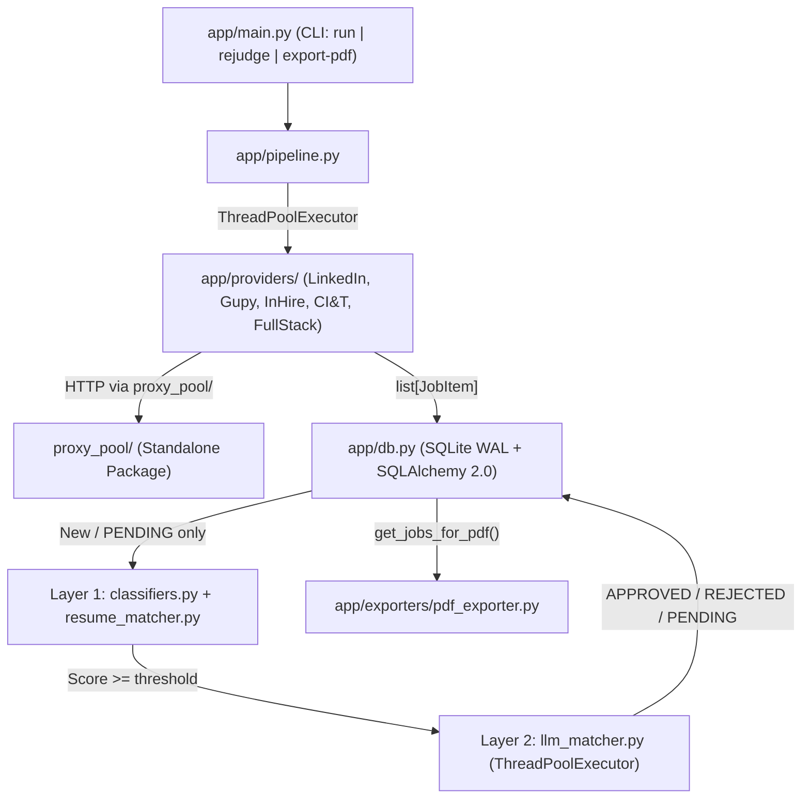

# Phase 1 Engineering Report: Debloat & SQLite Foundation

**Date:** 2026-11-25  
**Scope:** Backend simplification, notifier removal, `proxy_pool` package extraction, SQLite + SQLAlchemy 2.0 persistence, and fail-closed concurrent LLM evaluation.

---

## 1. Executive Summary

Phase 1 transformed `job-search` from an ephemeral JSON/Markdown/Telegram script into a **local-first monolith** backed by **SQLite (WAL mode)** as the Single Source of Truth, while cutting dead abstractions and isolating the proxy rotator for future packaging.

### What Was Removed
* **`app/notifiers/`** (`telegram_notifier.py`, `__init__.py`) and all Telegram settings/calls (`enviar_telegram`, `telegram_bot_token`, `telegram_chat_id`).
* **Redundant exporters:** `app/exporters/json_exporter.py`, `app/exporters/markdown_exporter.py`, and `tests/test_report_ordering_and_icons.py` (replaced by SQLite).
* **Legacy orchestration & dead models:** `app/facades/job_search_facade.py`, `app/pos_processamento.py`, `app/models/report.py` (`ProcessedDataOutput`), and `ItemTypeEnum` from `app/models/enums.py` and `app/models/job.py`.
* **Stale repo clutter:** Removed `browser-use` workspace reference from `pyproject.toml`, dead `jn-*` (JobNavigator) targets from `Makefile`, and generated `.pdf`/`.md`/`.json` artifacts from `app/data/` (now ignored in `.gitignore`).

### What Was Decoupled
* **`app/shared/http/` → `proxy_pool/`**: Extracted `record.py`, `sources.py`, `rotator.py`, and `client.py` into a top-level package with **zero `app.*` imports**, standard `logging.getLogger("proxy_pool")`, and explicit `tier_a_cache_path` injection.

### What Was Retained Temporarily
* **`app/exporters/pdf_exporter.py`**: Kept as the human-facing output (reading qualified and rejected jobs from SQLite) until the Phase 2 React dashboard is built, and decoupled from `ProviderRegistry` via a local `PROVIDER_BADGE_COLORS` map.

---

## 2. Target Architecture (Current State)

### Directory Layout
* `proxy_pool/` — Standalone reactive proxy rotator (`ProxyRecord`, `ProxySourcesCollector`, `RealtimeProxyRotator`, `requisicao_com_rotacao`).
* `app/core/` — Pydantic `Settings` (`config.py`) and structured logger (`logging.py`).
* `app/db.py` — SQLAlchemy 2.0 `DeclarativeBase` schema (5 tables) and repository functions.
* `app/models/` — Pydantic models & `StrEnum`s (`JobItem`, `ProfileMatch`, `LlmEvaluation`, `ResumeMatch`).
* `app/providers/` — 5 scrapers (`linkedin`, `gupy`, `inhire`, `ciandt`, `fullstack`) registered via `ProviderRegistry`.
* `app/profiles/` — Candidate profile & query sets (`DEFAULT_PROFILE`).
* `app/shared/classifiers.py` — Layer 1 fast regex/keyword heuristics.
* `app/matchers/` — Keyword scoring (`resume_matcher.py`) and concurrent LLM Judge (`llm_matcher.py`).
* `app/exporters/pdf_exporter.py` — Headless Chromium executive PDF generator.
* `app/pipeline.py` — Concurrent scrape → SQLite upsert → Layer 1/2 → PDF orchestration.
* `app/main.py` — `argparse` CLI (`run`, `rejudge`, `export-pdf`).

---

## 3. Patterns Established in the Codebase

### 3.1 Local-First Monolith + SQLite WAL (No Alembic)
* **Pattern:** Single-process Python execution using `ThreadPoolExecutor` for I/O concurrency and SQLite in WAL mode (`PRAGMA journal_mode=WAL; PRAGMA foreign_keys=ON;`) via SQLAlchemy 2.0 `Mapped[]` models.
* **Schema (`app/db.py`):** 5 tables created via `Base.metadata.create_all(engine)`—`jobs`, `job_evaluations`, `applications`, `tailored_resumes` (ready for Phase 3), and `scrape_runs`.
* **Why:** Zero infrastructure overhead and zero migration boilerplate for a single-user local tool.

### 3.2 Two-Key Cross-Run Deduplication (`url_hash` vs `canonical_key`)
* **`url_hash` (`UNIQUE` on `jobs`):** `sha256` (16 hex chars) of the normalized URL (lowercased scheme/host, stripped trailing slash, tracking query params `utm_*`, `trk`, `refId`, `trackingId` removed). Prevents re-scraping/re-judging the same posting across runs and updates `last_seen_at`.
* **`canonical_key` (Indexed, non-unique on `jobs`):** `sha256` (16 hex chars) of `company|title|work_model`. Groups cross-provider duplicates (e.g., LinkedIn + Gupy) without overwriting or losing direct ATS links.
* **Deterministic Provider IDs:** Replaced Python's randomized `hash(link)` in `linkedin/fetcher.py` and `ciandt/provider.py` with `hashlib.sha256(...).hexdigest()[:16]`.

### 3.3 Fail-Closed LLM Evaluation & `rejudge` Recovery
* **Pattern:** `LlmEvaluation.aprovado` defaults to `False` and `status` defaults to `"PENDING"`.
* **Behavior:** If the OpenAI-compatible LLM server is unreachable, times out, or returns invalid JSON, `llm_matcher.py` persists `llm_status = "PENDING"` instead of silently approving.
* **Recovery:** `make rejudge` (`python -m app.main rejudge`) queries `get_pending_llm_jobs()` and re-evaluates only `PENDING` rows without re-running scrapers.

### 3.4 Concurrent Fan-Out (Providers + LLM Judge)
* **Providers:** `app/pipeline.py` runs all active providers concurrently via `ThreadPoolExecutor(max_workers=len(provedores_ativos))`.
* **LLM Judge:** `filtrar_vagas_com_llm_em_lote()` evaluates surviving jobs concurrently via `ThreadPoolExecutor(max_workers=settings.llm_max_workers)` (default `4`).

### 3.5 Standalone Package Boundary (`proxy_pool/`)
* **Pattern:** Strict zero-import boundary—`proxy_pool/` never imports from `app.*`. Cache paths and logging are standard/injectable (`rotator.tier_a_cache_path = settings.proxy_tier_a_cache_file`).

### 3.6 Strategy + Registry for Providers (`app/providers/`)
* **Pattern:** `JobProviderStrategy` (Template Method: `search_jobs` → dedup → flexible title filter → concurrent `enrich_job`) + `ProviderRegistry` decorator registration.

---

## 4. Verification Baseline

* **Automated Tests:** `uv run python -m unittest discover tests` — **20 tests passing** (including `tests/test_db_and_dedup.py` covering WAL mode, `url_hash` dedup, non-unique `canonical_key`, and `rejudge` recovery).
* **Linting:** `uv run ruff check` — **All checks passed**.
* **CLI:** `uv run python -m app.main --help` — Exposes `run`, `rejudge`, and `export-pdf`.
